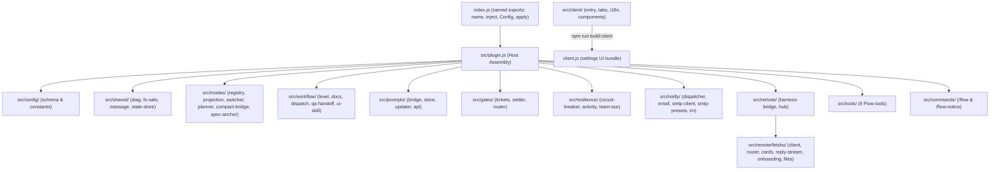

# Architecture Overview

`dsh-flow` is a pure-ESM Cordis plugin (`node >= 22.0.0`, `dsh >= 0.2.0 < 0.3.0`) that provides five workflow modes (`off`, `auto`, `flow`, `build`, `plan`), structured `.flow/docs/` artifacts, stage approval gates, an error circuit-breaker, multi-channel notifications, and a transport-agnostic `RemoteHub` with an official direct Feishu Commander adapter.

For onboarding and local debugging recipes, see [docs/DEVELOPING.md](./docs/DEVELOPING.md). For trust boundaries and security policies, see [SECURITY.md](./SECURITY.md).

## Module Dependency Map

## Five Core Runtime Flows

### 1. Cordis Lifecycle & Teardown

1. Root [index.js](./index.js) re-exports `name`, `inject`, `Config`, and `apply` from [src/plugin.js](./src/plugin.js) without a `default` export so the DeepSeek Harness (DSH) loader registers the plugin via named ES module exports.
2. `apply(ctx, rawConfig)` checks `process.versions.node` (requires `>= 22`), warns if host version falls outside `>=0.2.0 <0.3.0`, and wires services inside a scoped Cordis fork.
3. Hard dependencies declared in `inject` (`systemPrompt`, `commands`, `sessionProjections`, `agents`, `tools`) gate plugin activation, while optional services (`webServer`, `userQuestions`, `llm`, `credentials`, `workspaceRegistry`) are bound lazily via `holdOptional()`.
4. On `agent/disposed` or plugin unload, per-session disposers clear timers, abort in-flight compact/HTTP requests, unlock pending remote approvals, and close the Feishu WebSocket connection cleanly.

### 2. Mode Switching & Projection Folding

1. Session mode state is derived deterministically by `createModeProjection()` ([src/modes/projection.js](./src/modes/projection.js)) from `command/run` (`/flow <mode>`) and `tool/result` (`meta.flowTool`) events, defaulting to `off`.
2. When mode switches (`off` / `auto` / `flow` / `build` / `plan`) via `/flow <mode>`, `flow_switch_mode`, UI badge, or Feishu `/mode`, `applyModeSwitch()` ([src/modes/switcher.js](./src/modes/switcher.js)) validates model/permission readiness, resolves host model specs cleanly, and records state in the session log.
3. Prompt injectors in [src/prompts/bridge.js](./src/prompts/bridge.js) skip all Flow prompt injection when the active mode is `off`.

### 3. Stage Gate Ticket -> Settlement & Delivery

1. Agents request human checkpoints via `flow_stage_gate` ([src/tools/gate.js](./src/tools/gate.js)), creating persisted tickets managed by `createGateTickets()` ([src/gates/tickets.js](./src/gates/tickets.js)).
2. Tickets accept numeric desktop replies (`1`, `2`, `3`, `0`/`doc`) through `createGateRouter()` ([src/gates/router.js](./src/gates/router.js)) and remote settlement via `RemoteHub.settleGate()`.
3. `createGateSettler()` ([src/gates/settler.js](./src/gates/settler.js)) uses an `inFlight` lock to prevent concurrent double-settlement, compacts idle sessions before followup wakeups, and updates mode/permission grants atomically.

### 4. Error Circuit-Breaker & Recovery

1. `createCircuitBreaker()` ([src/resilience/circuit-breaker.js](./src/resilience/circuit-breaker.js)) tracks consecutive tool failures per session (`observe()`).
2. Reaching `circuit.threshold` trips the breaker (`lock()`): it cancels the active runaway turn, notifies `RemoteHub` (`onBrake`), triggers `/flow-notice` on settle, and arms an idle escalation timer.
3. Users recover via `1` (retry cleanly), `2` (escalate to `circuit.rescueModel`), `3 [new instruction]` (resume/cross-session handoff), plain corrective text, or Feishu card buttons.

### 5. Feishu Commander, Streaming Replies & High-Risk Approvals

1. `createFeishuClient()` ([src/remote/feishu/client.js](./src/remote/feishu/client.js)) loads `@larksuiteoapi/node-sdk` dynamically (`sdk-loader.js`), runs WebSocket long connections with local `NO_PROXY` guards, and honors credentials stored in DSH `credentials` (or falls back with an explicit warning).
2. `createFeishuRouter()` ([src/remote/feishu/router.js](./src/remote/feishu/router.js)) enforces a strict Fail-Closed `allowedOpenIds` allowlist (allowing only `/id` and `/whoami` outside the allowlist), binds `p2p` vs group `root_id` threads, and routes `@project`, `/m`, `/mode`, `/p`, `/stop`, `/new`, and `/approve <id> <pin>`.
3. `createReplyStreamer()` ([src/remote/feishu/reply-stream.js](./src/remote/feishu/reply-stream.js)) serializes streaming card updates and chunks long outputs at code-fence/table boundaries (`splitMarkdownChunks()`).
4. Tool permission requests pass through `classifyApprovalRisk()` ([src/remote/feishu/cards.js](./src/remote/feishu/cards.js)); high-risk operations (shell/write/delete/network) obey the configured 3-tier policy (`allow`, `pin`, or `desktop-only`).

## Engineering & Security Invariants

| Invariant | Enforcement / Verification | Source |
| --- | --- | --- |
| No `export default` in root entry | Tested in `test/unit/config-and-index.test.mjs` | [index.js](./index.js) |
| Generated settings UI stays synced with `src/client/` | Checked by `npm run build:client:check` | [scripts/build-client.mjs](./scripts/build-client.mjs) |
| Official prompt pack stays pinned to tag `v<version>` + SHA-256 | Checked by `npm run manifest:check` & `updater.js` | [scripts/sync-manifest.mjs](./scripts/sync-manifest.mjs) |
| No leftover `console.log(` or uncommented empty `catch {}` in `src/` | Checked by `npm run check` (`scripts/check-code.mjs`) | [scripts/check-code.mjs](./scripts/check-code.mjs) |
| Controlled writes never escape workspace root via traversal or symlinks | `assertInsideRoot()` & `normalizeRelDir()` | [src/shared/fs-safe.js](./src/shared/fs-safe.js) |
| Remote Feishu control fails closed when allowlist is empty | `isAllowedUser()` in `router.js` + `remote-feishu.test.mjs` | [src/remote/feishu/router.js](./src/remote/feishu/router.js) |
