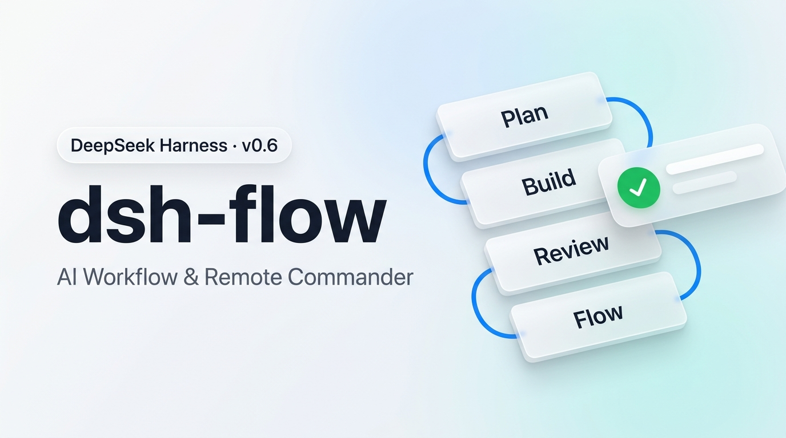
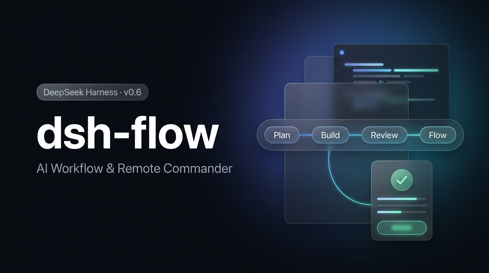
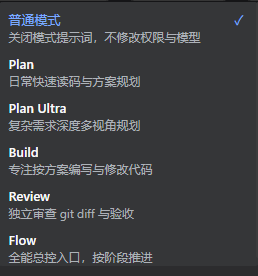
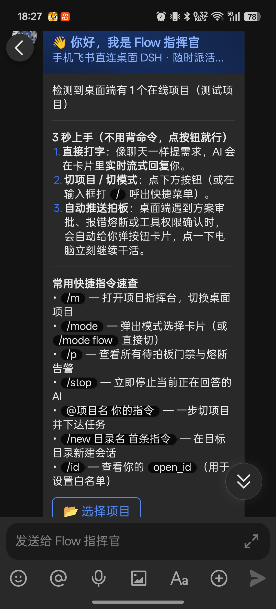
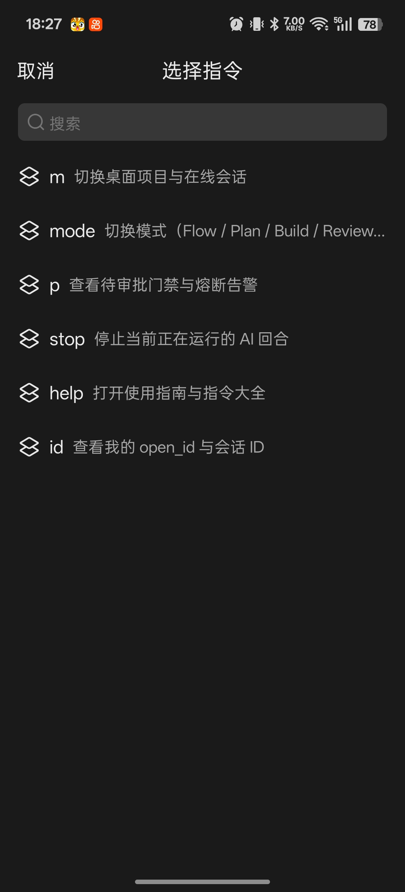
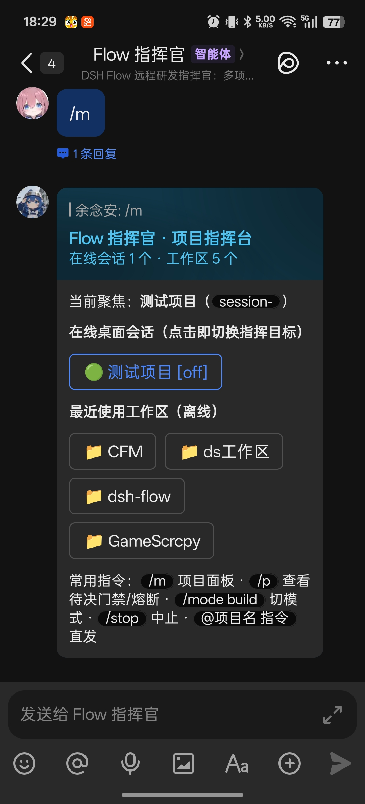
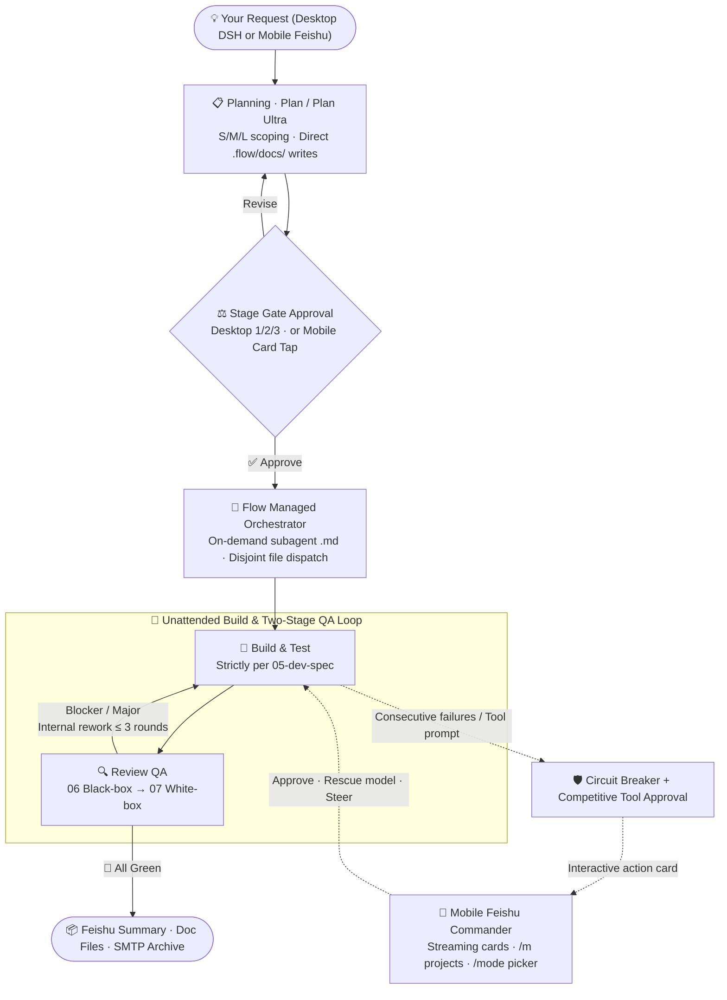
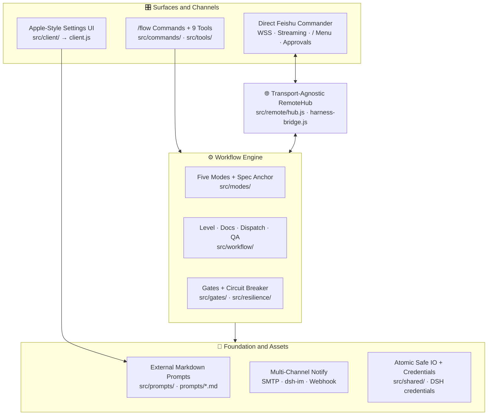

<p align="center">
  <picture>
    <source media="(prefers-color-scheme: dark)" srcset="./docs/assets/banner-dark.jpg" />
    <source media="(prefers-color-scheme: light)" srcset="./docs/assets/banner-light.jpg" />
    
  </picture>
</p>

<details align="center">
  <summary><sub>🌗 Auto-adapts to GitHub theme · Click to preview both banners (Light Studio / Dark Glass)</sub></summary>
  <br/>
  <table width="100%">
    <tr>
      <td width="50%" align="center">
        <br/>
        <sub><b>Light Studio Edition</b> (default in Light Mode)</sub>
      </td>
      <td width="50%" align="center">
        <br/>
        <sub><b>Dark Glass Edition</b> (auto-selected in Dark Mode)</sub>
      </td>
    </tr>
  </table>
</details>

<h1 align="center">dsh-flow</h1>

<p align="center">
  <b>An engineering-grade workflow supervisor, progressive prompt orchestrator, and direct Feishu/Lark mobile commander for DeepSeek Harness</b><br/>
  Five controllable workflow modes · Direct <code>.flow/docs</code> writes · Circuit breaker · Live streaming Feishu/Lark cards &amp; multi-project control
</p>

<p align="center">
  
  
  <a href="https://github.com/MeZenith/dsh-flow/actions/workflows/ci.yml"></a>
  
  = 22" />
  
  
</p>

<p align="center">
  <a href="./README.md">简体中文</a> | <b>English</b>
</p>

---

### Why dsh-flow?

When driving long coding chains with an LLM, the real cost is rarely "it cannot write code" — it is the rework created while it runs without guardrails:

* **Rushing ahead**: you wanted to clarify requirements and architecture first, yet the model already edited a dozen files;
* **Re-inventing a worse wheel**: the project already ships a reusable component, host API, or mature library, but the model hand-rolls a fragile replacement;
* **Tail fatigue and orphan wiring**: as context grows, the second half of a file degrades, new modules ship without callers wired, and the summary still claims "all done";
* **Error loops and desk lock-in**: repeated tool failures spin in circles burning tokens, and once you step away from your desk, plan approvals or command prompts stall indefinitely.

`dsh-flow` pairs a **12-rule engineering contract, five-mode workflow engine, consecutive-failure circuit breaker, and a built-in Direct Feishu/Lark Commander**, turning your AI into a disciplined, remotely steerable engineering team.

---

### Design Philosophy

1. **Enforce guardrails in code, not wishful prompts**: file-write allowlists, gate tickets, failure circuit breakers, and 3-round rework caps are implemented as hard runtime guards rather than polite suggestions.
2. **Protect human attention for real decisions**: S/M/L scoping, direct `.flow/docs/` writes, and non-blocking stage gates pause only when your judgement matters — everything else closes internally.
3. **One command center across desktop and phone**: desktop DSH and mobile Feishu share the transport-agnostic `RemoteHub`, enabling live streaming cards, competitive dual-side approvals, and quiet desktop separation.
4. **Progressive disclosure, zero context bloat**: prompts live in hot-reloaded Markdown files; orchestrators read only a lean index and load specialist prompts on demand, while private overrides live safely outside the plugin package.
5. **Zero server, zero black box, modular composition**: the built-in Feishu commander needs no VPS, tunnel, or companion IM plugin — scan a QR code in 30 seconds; standalone workflows run out of the box, and full multi-agent team orchestration pairs seamlessly with `dsh-team-control`; every delivery ships with an auditable verification receipt.

---

### What's New in v0.6.0

#### 1. Built-in Direct Feishu / Lark Commander (Zero Server · Zero Tunnel · 30-Second QR Setup)
* **Custom Bot Identity & One-Click QR Provisioning**: Pick your bot's name and avatar (6 built-in presets or any public image URL) in Settings, scan the on-screen vector QR code with Feishu/Lark mobile, and an outbound WebSocket long connection establishes automatically — **no public IP, no VPS, no Tailscale, and no prerequisite IM plugin required**.
* **Live Streaming Reply Cards**: Ask any question directly in Feishu and receive a live updating card — showing real-time tool activity (with a `[⏹ Stop]` button), smooth streaming text updates (CardKit streaming with automatic `message.patch` fallback), and a finalized Markdown card with quick footer buttons (`[📂 Switch Project]` `[🧭 Switch Mode]` `[📋 Pending]` `[📖 Guide]`).
* **Native Feishu `/` Slash Command Menu & Welcome Guide Card**: Automatically registers Feishu's native `/` input command panel (`/m`, `/mode`, `/p`, `/stop`, `/help`, `/id`) and sends a friendly 3-second onboarding card upon connection — zero commands to memorize.
* **Multi-Project Control & Competitive Remote Approvals**:
  * `/m` opens an interactive workspace/session switcher card; `@project your prompt` switches focus and dispatches in one message;
  * `/mode` opens a visual 6-mode picker card to switch desktop modes with one tap;
  * **Three Interactive Approval Cards**: Stage gates, circuit-breaker rescues, and **native DSH tool execution approvals (`approval/request`)** push clickable cards to your phone — whichever side (desktop or mobile) acts first wins immediately and syncs the other side;
  * **Noise-Free Separation**: Feishu-initiated chats always stream back to Feishu; desktop-initiated everyday chats stay quiet on mobile by default (only gates, breaker trips, completions, and tool approvals push), with an optional **"Mirror Desktop Replies"** toggle in Settings when you step away.

#### 2. Apple-Minimalist Settings UI
* Redesigned all four tabs (`Modes` / `Workflow` / `Feishu` / `Prompts`) with Apple-style inset grouped lists, segmented controls, tactile toggle switches, steppers, and collapsible advanced drawers;
* Guided 3-state Feishu pairing hero card (customize → centered vector QR with 3-step live tracker → connected next-step guide & one-click permission upgrade).

#### 3. Workflow Refinements & Modular Architecture
* **Direct `.flow/docs/` Writes by Default**: `docs.writePolicy` defaults to `auto` (switchable back to `ask`), keeping business code strictly read-only in Plan mode while eliminating redundant write-permission prompts before plan review;
* **Clean 11-Layer `src/` Architecture & Automated CI**: Refactored 29 flat root scripts into modular `src/` layers + modular `src/client/` bundle builder (`npm run build:client`), backed by **40+ automated `node:test` suites with Linux/Windows Node 22/24 CI & coverage gates** covering gates, docs, circuit breaker, SMTP, prompt API, and end-to-end Feishu streaming & approvals.

---

### Built-in Direct Feishu Commander vs. `dsh-im`

| Dimension | Built-in Direct Feishu Commander (`dsh-flow` v0.6.0+) | Pairing with `dsh-im` (Optional, Fully Compatible) |
| :--- | :--- | :--- |
| **Role** | Purpose-built mobile remote commander for the **Flow engineering workflow** | General-purpose multi-platform IM bridge (WeChat, WeCom, DingTalk, Feishu, Telegram, etc.) |
| **Prerequisite** | **Standalone** — install `dsh-flow`, scan QR, ready in 30 seconds | Optional — install if you also want WeChat / WeCom / DingTalk delivery |
| **Multi-project steering** | Native `/m` project hub & `@project prompt` switching across all workspaces | Primarily session/workspace-bound |
| **Workflow interactivity** | Streaming reply cards, native `/` menu, `/mode` picker, in-place updated gate/breaker/tool-approval cards, direct `.flow/docs` file uploads | Text summaries & numeric fallback replies |
| **Coexistence** | **Zero conflict** — Feishu runs as primary channel while `dsh-im`, custom Webhooks, and built-in SMTP email remain available under *Email & Other Channels* | Can be enabled alongside Feishu or SMTP archival anytime |

---

### Recommended Companion Plugins (Optional, Strongly Recommended)

`dsh-flow` runs standalone out of the box with zero mandatory prerequisites. Pairing it with the optional companions below unlocks the best experience on large, multi-turn projects:

| Companion Category | Recommended Plugin / Capability | Synergy & Compatibility |
| :--- | :--- | :--- |
| **Long-Context Compression**<br>*(Strongly Recommended)* | [`billion-context`](https://github.com/ranxianglei/billion-context) | Strongly recommended for `M / L` projects and long-running sessions: provides protocol-level incremental context compression, KV cache preservation, and on-demand recall. `dsh-flow` automatically detects `billion-context` (`bili-native`) and yields stage-gate auto-compaction to avoid conflicts. |
| **Concurrent Multi-Agent Team**<br>*(Optional)* | `dsh-team-control` / DSH subagent orchestration | Without it, `dsh-flow` executes cleanly in single-threaded lead mode; with it installed, disjoint file-allowlist dispatch unlocks parallel build and two-stage QA delegation. |
| **UI Design & Motion Skills**<br>*(Optional)* | UI design skills (e.g., `ui-ux-pro-max`, `animate`) | Automatically discovered via `flow_ui_skill` for UI tasks and folded into `04-ui-spec.md` for higher visual and interaction polish. |

---

### Interface & Live Previews

#### 1. Apple-Minimalist Settings Workbench & Mode Chip

<table width="100%">
  <tr>
    <td width="50%" align="center" valign="top">
      <br/>
      <sub><b>Workflow &amp; Breaker</b>: segmented controls, toggle switches, stepper, and collapsible advanced drawer</sub>
    </td>
    <td width="50%" align="center" valign="top">
      <br/>
      <sub><b>Feishu Remote Commander</b>: live status, native <code>/</code> menu badge, 6 push toggles &amp; allowlist</sub>
    </td>
  </tr>
  <tr>
    <td colspan="2" align="center" valign="top">
      <br/>
      <sub><b>Desktop composer mode chip</b>: switch Plan / Plan Ultra / Build / Review / Flow in one click</sub>
    </td>
  </tr>
</table>

#### 2. Live Mobile Feishu Commander Screenshots

<table width="100%">
  <tr>
    <td width="33%" align="center" valign="top">
      <br/>
      <sub><b>Welcome &amp; 3-Second Guide</b><br/>Sent automatically on connect</sub>
    </td>
    <td width="33%" align="center" valign="top">
      <br/>
      <sub><b>Native <code>/</code> Command Panel</b><br/>Type <code>/</code> to pick commands visually</sub>
    </td>
    <td width="33%" align="center" valign="top">
      <br/>
      <sub><b><code>/m</code> Project Hub</b><br/>Switch active sessions &amp; workspaces</sub>
    </td>
  </tr>
  <tr>
    <td colspan="3" align="center">
      <table width="100%">
        <tr>
          <td width="50%" align="center" valign="top">
            <br/>
            <sub><b>Live Streaming Reply Card</b>: full Markdown response + 4 quick action buttons</sub>
          </td>
          <td width="50%" align="center" valign="top">
            <br/>
            <sub><b><code>/mode</code> Visual Mode Switcher</b>: switch desktop modes with one tap</sub>
          </td>
        </tr>
      </table>
    </td>
  </tr>
</table>

---

### Core Engineering System & Architecture

* **12-Rule Base Contract (`prompts/base.md`)**: Rolls-Royce reuse rule, evidence-first debugging with 2-strike stop-loss, non-blocking stage gates, download traffic lights (`<20MB` / `20–300MB` / `≥300MB`), destructive-action guardrails, and mandatory auditable verification receipts.
* **S / M / L Task Scoping & `.flow/docs/` (01–07)**: `05-dev-spec.md` acts as the single source of truth; `.flow/spec.md` stays pinned across context compactions; black-box (`06`) → white-box (`07`) two-stage QA loops internally up to 3 rework rounds before escalating.
* **External Markdown Prompt Library + Copy-on-Write Isolation**: 5 workflow modes + 10 specialist subagents (`prompts/subagents/`), hot-reloaded from disk. Private overrides live outside the plugin package (`$DSH_PROFILE_DIR/data/dsh-flow/prompts/custom`, fallback `~/.dsh-flow/prompts/custom`) and survive every plugin or prompt update.

#### End-to-End Runtime Flow



#### Layered Module Architecture



---

### Installation, Ecosystem Companions & Quick Start

* **Requirements**: DeepSeek Harness `0.2.x`+ · Node.js `22`+

> [!IMPORTANT]
> **Companion Plugin Matrix (Standalone vs. Strongly Recommended vs. Optional)**
>
> | Component / Plugin | Necessity | Role |
> | :--- | :--- | :--- |
> | **`dsh-flow` (core)** | **Works standalone** | Ships all five workflow modes, numbered docs & gates, circuit breaker, built-in SMTP archival, and the **Direct Feishu/Lark Commander** out of the box. |
> | **[dsh-team-control](https://github.com/hunmer/dsh-team-control/)** ([@hunmer](https://github.com/hunmer)) | **🔥 Strongly recommended for `Flow` team orchestration** | `Flow` and `Plan Ultra` dispatch prioritize `dsh_team_spawn` and team SSE monitoring from `dsh-team-control`. **Installed** = full parallel subagent teams, dashboard & team alerts pushed to Feishu. **Absent** = no crash; gracefully falls back to host `subagent` or single-thread execution and notes it in the receipt. |
> | **[dsh-im](https://github.com/xmanrui/dsh-im)** ([@xmanrui](https://github.com/xmanrui)) | **Optional** | No longer required in v0.6.0; install only if you also want WeChat / WeCom / DingTalk delivery alongside Feishu. |

```bash
# Install from GitHub (use `desktop` instead of `web` for the desktop profile)
dsh plugin --profile web add github:MeZenith/dsh-flow
```

Restart DSH and refresh with `Ctrl + R`. Open **Settings → Flow Workflow → Feishu**, customize your bot's name & avatar, and click **Scan QR to Create & Connect Bot** to go live in 30 seconds.

#### Upgrading

```bash
# In-place update (preserves settings, credentials, and private prompts)
dsh plugin --profile web update dsh-flow

# Reinstall fallback if needed
dsh plugin --profile web remove dsh-flow
dsh plugin --profile web add github:MeZenith/dsh-flow
```

For full technical architecture, local loopback API specs, and subagent authoring contracts, see **[docs/DETAIL.md](./docs/DETAIL.md)**, **[CONTRIBUTING.md](./CONTRIBUTING.md)**, and **[CHANGELOG.md](./CHANGELOG.md)**.

---

### Security Trust Model & Known Limitations

* **Remote Trust Boundary**: Feishu allowlist (`feishu.allowedOpenIds`) enforces strict Fail-Closed access (empty allowlist permits only `/id` and `/whoami`). An allowlisted Feishu account can dispatch tasks to active DSH sessions; configure `High-Risk Tool Approvals` in Settings (`Allow via Feishu` / `Require PIN` / `Desktop Confirmation Only`) to restrict destructive operations.
* **Host & Runtime Matrix**: Verified on `DeepSeek Harness 0.2.x` (`0.2.2-rc.4` baseline) and `Node.js >= 22`. Unsupported Node or host versions emit explicit startup diagnostics.
* **Built-in Zero-Dep SMTP Scope**: Verified against QQ Mail, 163 Mail, Gmail, and standard SSL/STARTTLS relays; exotic enterprise mail servers may require custom webhooks.
* **Vulnerability Disclosure & Dependency Audit**: See **[SECURITY.md](./SECURITY.md)** for security policy, credential storage fallback notices, and `@larksuiteoapi/node-sdk` transitive dependency notes.

---

### Acknowledgements

* **[OpenCode](https://github.com/anomalyco/opencode)** — inspiration for the `Plan` / `Build` separation and multi-mode workflow design.
* **[dsh-team-control](https://github.com/hunmer/dsh-team-control/)** ([@hunmer](https://github.com/hunmer)) — multi-agent team orchestration and monitoring in the DeepSeek Harness ecosystem.
* **[dsh-im](https://github.com/xmanrui/dsh-im)** ([@xmanrui](https://github.com/xmanrui)) — multi-platform IM integration and Feishu SDK reference in the DeepSeek Harness ecosystem.

---

### License

Released under the **[Apache License 2.0](./LICENSE)** (Copyright 2026 MeZenith):

* Permitted for personal and commercial use, modification, derivative works, and redistribution, with explicit patent grant;
* Keep copyright notices and a copy of `LICENSE` on redistribution; contributions follow Apache-2.0 Section 5.

See [THIRD_PARTY_NOTES.md](./THIRD_PARTY_NOTES.md) for third-party component notices.
