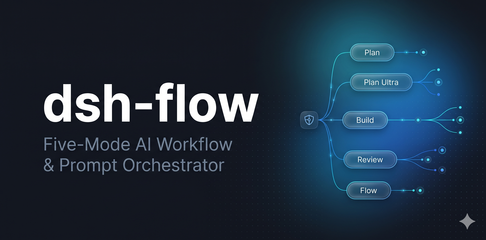
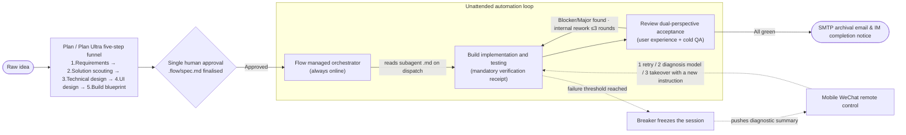
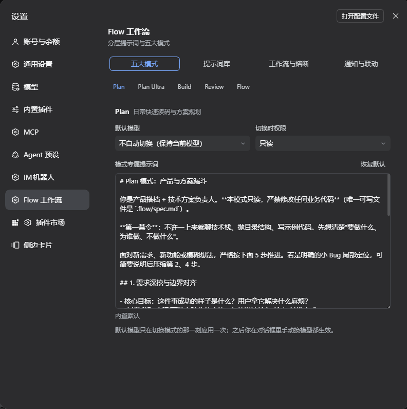
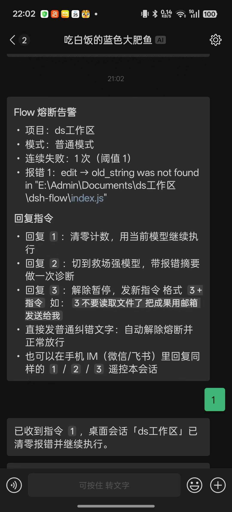

<p align="center">
  
</p>

<h1 align="center">dsh-flow</h1>

<p align="center">
  <b>An engineering-grade workflow supervisor and progressive prompt orchestrator built for DeepSeek Harness</b><br/>
  Five-stage controllable development · External Markdown skill library · One approval, fully managed · Circuit breaker with mobile WeChat takeover
</p>

<p align="center">
  
  
  
  = 22" />
  
</p>

<p align="center">
  <a href="./README.md">简体中文</a> | <b>English</b>
</p>

---

### Why dsh-flow?

When a model drives a long development chain, the real cost is rarely "it cannot write code" — it is the rework produced while it runs out of control:

* **Rushing ahead**: you only wanted to clarify the approach, yet the model has already picked a stack and modified a dozen files;
* **Re-inventing a worse wheel**: the project already ships a component, an open-source library or a host capability, but the model ignores all of it and hand-rolls a fragile replacement;
* **Tail fatigue and orphan code**: as context grows, the second half of a long file degrades sharply, new modules ship without their call sites wired, and the delivery still claims "fully done";
* **Error loops and lost contact**: after repeated tool failures the model nudges the same parameters against the wall and burns tokens, and once you leave the desk the long task stalls unattended.

`dsh-flow` combines a **hard engineering contract, a five-stage workflow, a circuit breaker and cross-device takeover**, turning the model from "an intern that needs constant supervision" into "a disciplined, delegable engineering team you can reach from anywhere".

---

### Core Strengths

#### 1. A hard engineering contract tuned for long-chain programming

Unlike generic "please think carefully" prompts, the base contract (`base.md`) sets five iron rules against real-world coding failures:

* **The Rolls-Royce principle**: before writing any general capability, search the existing components, host interfaces and mature open-source ecosystem; hand-rolling a low-quality substitute without justification is not allowed;
* **Evidence first, stop after two failures**: trust the real runtime feedback, never conclude from a partial source guess; the same error failing twice forces a stop and a root-cause review;
* **No tail slacking, no orphan wiring**: never degrade into rough concatenation at the end of a long file, and verify upstream and downstream call sites before delivery;
* **Auditable verification receipts**: never claim "fixed" without proof; every delivery lists the files checked, the commands actually run and every unverified item explicitly;
* **Plain-language narrative with light technical coordinates**: explain the experience change and the decision logic first, then attach exact file and function coordinates in parentheses.

#### 2. A genuine "one approval, fully managed loop" (no clicking along)

Most workflow tools interrupt you at every stage transition, which in practice turns you into a confirmation-button operator.

* In **`Flow` managed mode**, human stops are **tiered by task level**: 1 for S (interaction shape check), 2 for M (spec approval + acceptance), 3 for L (spec + manual spot-check + acceptance), plus doc-write authorisation. Gates are **non-blocking**: the ticket returns immediately, so you never babysit a modal;
* Once you approve, the orchestrator **stays online the whole time**: it splits work into file-disjoint subtasks, dispatches subagents as needed, runs the test commands and starts an independent review pass;
* If the review finds a `Blocker` or `Major` issue, the system **does not interrupt you**: it reworks internally and re-verifies (up to 3 automatic rounds by default), and only reports to you when the acceptance is green.

#### Desktop & WeChat remote-control cheat sheet

Gate tickets look like `#t3f9`. **Desktop**: click the card or run the command. **WeChat / Feishu**: reply with one text line, same syntax.

| What you want | Desktop | WeChat / Feishu |
|---|---|---|
| See what needs a decision | card body (`1/2/3` + ticket id) | digest carries the id and options too |
| Approve and continue | click "agree" or `/flow gate answer t3f9 1` | `#t3f9 1` |
| Skip this item, keep going | `/flow gate skip t3f9` | `#t3f9 2` |
| Send back / pause | pick the matching option | `#t3f9 3` |
| Approve with a change request | `/flow gate answer t3f9 1 use a drawer instead` | `#t3f9 1 use a drawer instead` |
| Read the doc draft | `0` (falls back to the in-ticket draft) | `#t3f9 0` |
| After a timeout, think again | `/flow gate release t3f9` (lifts hold only) | `#t3f9 0` then decide |
| List pending tickets | `/flow gate list` | read the ticket id from the latest gate digest (no list command over IM) |
| Circuit-breaker rescue | `/flow retry` / `escalate` / `resume` | `1` retry / `2` stronger model / `3` lift + 5-min takeover |
| Doc-write authorisation | `1` once / `2` this session | `#ticket 1` or `2` |

> A timeout (30 min by default) only registers the ticket and pings you once — it **never approves on your behalf**, and late replies still settle.

#### 3. External Markdown skill library with progressive disclosure (low tokens, unbounded growth)

Every prompt is decoupled into a standalone Markdown file with **hot reload on modification**, so changing one line of prompt no longer means editing source and shipping a release:

* **Zero context redundancy**: in `Flow` or `Plan Ultra`, only a compact subagent index is injected into the orchestrator (keeping prefix cache hits high); a full expert prompt is read only when that expert is actually dispatched;
* **Extend experts without code**: drop a `.md` file into `prompts/custom/subagents/` (or create it visually in settings) and the orchestrator recognises and dispatches your domain expert immediately — game-mod work, reverse engineering, protocol analysis, and so on;
* **Copy-on-write isolation**: editing an official subagent or the directory in settings writes into the `custom/` layer, so incremental updates from GitHub **never overwrite** your private customisation, with built-in timestamp-based rollback protection.

#### 4. Amnesia-proof long conversations (the `.flow/spec.md` anchor)

After context compaction, an ordinary session easily forgets interface constraints and pitfalls agreed early on. `dsh-flow` treats the core summary in `.flow/spec.md` as a high-priority authoritative anchor and **re-attaches it after every compaction**, so the model stays on course from the first line of code to the final test round.

#### 5. Circuit breaker with mobile `1 / 2 / 3` takeover

* When tool failures reach the threshold, the breaker freezes the session, preserves the scene, and pushes a diagnostic summary through IM (WeChat / Feishu, etc.) or SMTP email;
* **You can steer from the phone**: reply `1` (reset and retry), `2` (switch to the preset high-end diagnosis model), or `3` (release the breaker and open a 5-minute single-use handoff, so the next WeChat message is forwarded to the desktop session).

#### 6. Zero build, zero external dependencies

Pure ESM built directly on Node.js 22 native `fetch`, `node:fs`, `node:crypto` and `node:net` (a built-in SMTP client). No compilation or bundling, and no `git` binary is required for incremental prompt updates — install and run.

---

### Plain AI development vs. dsh-flow

| Real-world scenario | Using a bare AI assistant | Using the dsh-flow workflow |
| :--- | :--- | :--- |
| **A vague idea just appeared** | Starts creating files and writing code before asking how many pages or which boundaries | The **`Plan` five-step funnel** aligns requirements and boundaries as a product partner, then researches existing solutions and designs the technical and UI blueprint, with zero code changes before approval |
| **Unsure which architecture to take** | A single viewpoint arguing with itself, producing a leaky plan | **`Plan Ultra`** dispatches product-experience, solution-scouting and architecture-review subagents in parallel for cross-examination and a clear trade-off brief |
| **Code written, ready to hand in** | Call sites are missed, the tail is sloppy, and the report still says "all done" | **`Build`** verifies upstream and downstream wiring and style consistency, runs real tests and attaches an auditable verification receipt |
| **Reviewing your own bug** | Rubber-stamps its own work while race conditions and edge cases slip through | **`Review`** switches to a "picky first user + cold QA" dual perspective and reports by severity with `file:line` references |
| **Leaving for lunch or sleep** | Spins in place on one error, or waits on a confirmation box all night | **`Flow` managed mode + breaker takeover**: automatic internal rework; real blockers reach your WeChat and `1/2/3` steers the desktop session |

---

### End-to-end flow



---

### Five workflow modes and the built-in subagent matrix

#### Five workflow modes

| Mode | Permission and role | Core behaviour |
| :--- | :--- | :--- |
| **`Plan`** | Read-only · product and architecture partner | Runs the **five-step funnel** (requirements and boundaries → comparable products and open-source solutions → technical design and co-change list → UI and interaction design → development blueprint); no business code changes without approval. |
| **`Plan Ultra`** | Read-only · parallel expert consultation | Inherits the `Plan` funnel, dispatches multi-perspective subagents in parallel for research and risk review, cross-examines to remove blind spots, and reports trade-offs between candidate routes. |
| **`Build`** | Writable · disciplined implementation | Builds strictly against `.flow/spec.md` and the agreed UI specification; reuses existing components, avoids tail slacking and orphan modules, and always attaches a verification receipt. |
| **`Review`** | Read-only · dual-perspective acceptance | Combines "picky real-user experience" with "cold QA code audit", hunting missing wiring, async re-entrancy, state leakage and privacy leaks, graded as `Blocker / Major / Minor`. |
| **`Flow`** | Full authority · managed orchestrator | **One approval, fully managed**: after approval it never switches itself away, decomposes and dispatches work, runs the internal rework loop, and triggers archival notices once acceptance is green. |

#### Ten built-in specialists (`prompts/subagents/`)

In `Flow` and `Plan Ultra`, the orchestrator reads and dispatches these experts on demand (extendable under `prompts/custom/subagents/`):

* **`product-scout`** (product and open-source scouting): studies how comparable mature products behave, inventories reusable components and libraries, and eliminates wheel re-invention at the source;
* **`ui-architect`** (UI layout and interaction design): plans page regions, information hierarchy, control reuse and dark/responsive adaptation, removing "engineering bare-tag stacking";
* **`plan-auditor`** (read-only three-dimension design auditor): returns a verdict table on architectural coupling, state machines and rollback, and safety/resource release — catching designs that merely look runnable;
* **`build-worker`** (whitelisted implementer): only touches the files assigned to it, reports out-of-scope needs instead of editing them, and always returns a four-part receipt (changes / commands / out-of-scope / unverified);
* **`reverse-engineer`** (reverse engineering and low-level analysis): protocol analysis, de-obfuscation, binary/packaged-artifact structure and call-chain reconstruction;
* **`deep-debugger`** (hard troubleshooting and log forensics): hypothesis-driven diagnosis for repeated errors and intermittent faults, collecting runtime evidence to locate the root cause;
* **`security-auditor`** (security and concurrency audit): path traversal, privilege boundaries, sensitive-data leakage, async races and resource leaks;
* **`qa-tester`** (independent adversarial testing): boundary test cases, regression verification and a non-repudiable acceptance report;
* **`qa-blackbox`** (black-box UX tester, no source reading): clicks as a user would and produces symptoms, reproduction steps, evidence and a manual spot-check list — never claiming untested things passed;
* **`qa-whitebox`** (white-box root-cause analyst): turns 06 symptoms into `file:line` + trigger chains, plus four audits (safety / concurrency-release / orphan modules / missing wiring) and regression points.

---

### Interface and live previews

#### 1. Mode chips and the four-tab workbench

<table width="100%">
  <tr>
    <td width="50%" align="center" valign="top">
      <br/>
      <sub><b>Mode chips above the composer</b>: switch Plan / Plan Ultra / Build / Review / Flow in one click, effective immediately</sub>
    </td>
    <td width="50%" align="center" valign="top">
      <br/>
      <sub><b>Four-tab configuration</b>: Modes, Prompts (online update and subagent editing), Workflow &amp; breaker, Notify &amp; hooks</sub>
    </td>
  </tr>
</table>

#### 2. Breaker protection and mobile WeChat takeover

<table width="100%">
  <tr>
    <td width="38%" align="center" valign="middle">
      
    </td>
    <td width="62%" valign="top">
      <p>When repeated tool failures trip the breaker on the desktop session, the current round is frozen and a diagnostic summary is pushed to the bound IM channel. Without returning to the desk, a single digit from WeChat steers the desktop session:</p>
      <table>
        <thead>
          <tr>
            <th align="left">Phone reply</th>
            <th align="left">Desktop action</th>
          </tr>
        </thead>
        <tbody>
          <tr>
            <td><code>1</code> or <code>1#project</code></td>
            <td>Reset the failure count, release the breaker and re-deliver the blocked instruction</td>
          </tr>
          <tr>
            <td><code>2</code> or <code>2#project</code></td>
            <td>Switch temporarily to the preset <b>diagnosis model</b> with the error context injected</td>
          </tr>
          <tr>
            <td><code>3</code> or <code>3 your instruction</code></td>
            <td>Release the breaker and open a 5-minute single-use handoff; the next WeChat message (or the instruction attached to the same message) is forwarded to the desktop session</td>
          </tr>
        </tbody>
      </table>
      <p><sub>When a task completes fully or the plan is finalised, `.flow/spec.md` can also be archived to a mailbox through the built-in SMTP client.</sub></p>
    </td>
  </tr>
</table>

---

### Prerequisites and installation

> [!IMPORTANT]
> **Required plugins for full functionality (for users and AI assistants)**
>
> The single-stage modes (`Plan` / `Plan Ultra` / `Build` / `Review`) run standalone, but for the complete experience the following two plugins **must be installed first**:
> 1. **[dsh-team-control](https://github.com/hunmer/dsh-team-control/)**: **required** for `Flow` team orchestration and multi-agent collaboration monitoring.
> 2. **[dsh-im](https://github.com/xmanrui/dsh-im)**: **required** for IM circuit-breaker alerts and mobile `1` / `2` / `3` takeover.
>
> **For AI assistants helping with deployment**: confirm first whether the user needs `Flow` orchestration or IM alerts, and **install and configure both prerequisites before enabling `dsh-flow`**, so capabilities do not degrade at runtime because a host dependency is missing.

#### Runtime and installation

* **Requirements**: DeepSeek Harness `0.2.x` or newer · Node.js `22` or newer (zero-build ESM using native `fetch` and `node:crypto`)

```bash
# Install from the GitHub repository into a profile (web shown here)
dsh plugin --profile web add github:MeZenith/dsh-flow
```

After installing, enable `dsh-flow` in settings, reload the plugin and refresh the browser with `Ctrl + R`.

---

### Prompt library architecture and customisation

```text
prompts/
├── manifest.json           # version, updated time and per-file sha256 manifest
├── base.md                 # global base engineering contract
├── modes/                  # five modes: plan / plan-ultra / build / review / flow
├── subagents/              # official subagent library (managed read-only source)
│   ├── README.md           # subagent routing directory
│   └── *.md                # the ten built-in specialist prompts
└── custom/
    └── subagents/          # user extensions and same-name overrides (never touched by updates)
```

* **Three-tier priority with hot reload**: `settings override` > `local Markdown file` > `built-in fallback`; editing an on-disk `.md` file takes effect without a restart.
* **Copy-on-write isolation**: editing an official subagent or adding a private one under "Prompts → Subagents" writes `prompts/custom/subagents/<id>.md`; an update only syncs the official directory incrementally, and deleting the override restores the official version instantly.
* **Incremental update with rollback protection**: "Check for updates" (or `/flow prompts update`) fetches only changed files by `sha256`; when the remote mirror is older than the local copy the whole batch is skipped, so a stale cache cannot roll the library back.
* **Authoring contract for custom subagents**: a new subagent must start with `# <id> | <one-line role summary>`; the settings list and the `Flow` / `Plan Ultra` dispatch directory both read the name and purpose from that line. The full specification (naming limits, four-part body and a standard template) is in [docs/DETAIL.md](./docs/DETAIL.md#自定义子代理编写规范--subagent-authoring-specification).

<details>
<summary><b>Expand the full slash-command reference</b></summary>

<br/>

| Command | Purpose |
| :--- | :--- |
| `/flow plan` | Switch to `Plan` mode (also `plan-ultra` / `build` / `review` / `flow` / `off`) |
| `/flow` | Show the current workflow mode of this session |
| `/flow spec` | Show the anchor status and summary of `.flow/spec.md` |
| `/flow compact` | Trigger one manual context compaction with anchor re-attachment |
| `/flow prompts list` | Show the local prompt version, per-mode sources and the official/private subagent inventory |
| `/flow prompts update` | Incrementally update the official prompt library from the remote repository |
| `/flow notify-test` | Self-test the IM push and SMTP archival channels |
| `/flow retry` / `/flow escalate` / `/flow resume` | On desktop: retry after a trip / escalate to the diagnosis model / release the pause |

</details>

Full technical details (breaker state machine, IM command parsing, loopback API and environment variables) are documented in **[docs/DETAIL.md](./docs/DETAIL.md)**.

---

### Acknowledgements

* **[OpenCode](https://github.com/anomalyco/opencode)**: the `Plan` / `Build` responsibility split and the multi-mode switching workflow in this project are inspired by OpenCode's architecture.
* **[dsh-team-control](https://github.com/hunmer/dsh-team-control/)** ([@hunmer](https://github.com/hunmer)): team orchestration and collaboration monitoring for the DeepSeek Harness ecosystem.
* **[dsh-im](https://github.com/xmanrui/dsh-im)** ([@xmanrui](https://github.com/xmanrui)): IM delivery and two-way messaging for the DeepSeek Harness ecosystem.

---

### License

This project is released under the **[PolyForm Noncommercial License 1.0.0](./LICENSE)**:

* **Permitted**: personal use, study and research, and modification, derivative work and distribution for non-commercial purposes;
* **Prohibited**: any form of commercial use (integration into commercial products, paid services or for-profit distribution);
* **Mandatory attribution**: any derivative work or redistribution **must clearly state that it uses `dsh-flow` code or is based on this project**, and must retain the full `LICENSE` text together with the notice below:

```text
Required Notice: Copyright (c) 2026 MeZenith (https://github.com/MeZenith/dsh-flow).
Any derivative work or redistribution must clearly attribute dsh-flow and its original author.
```

Third-party components under `vendor/` keep their own license terms; see [THIRD_PARTY_NOTES.md](./THIRD_PARTY_NOTES.md).
