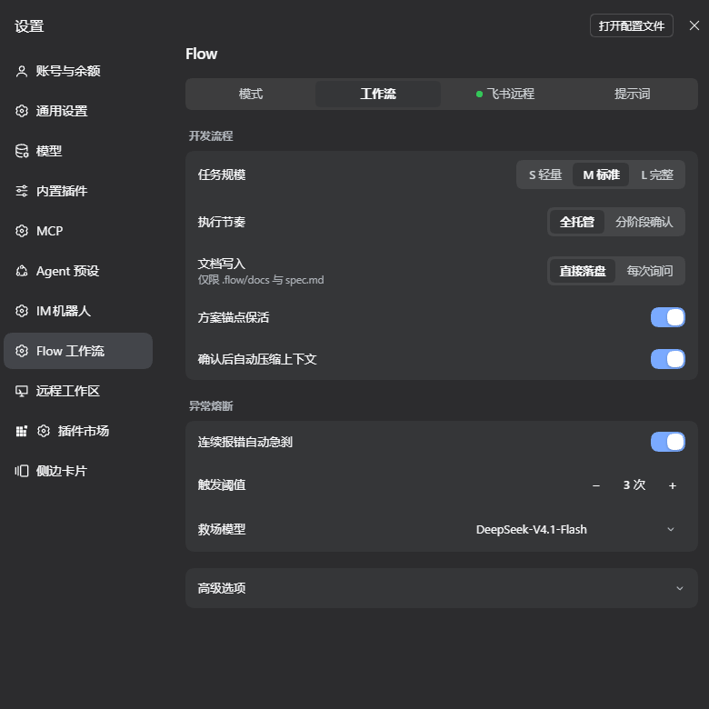
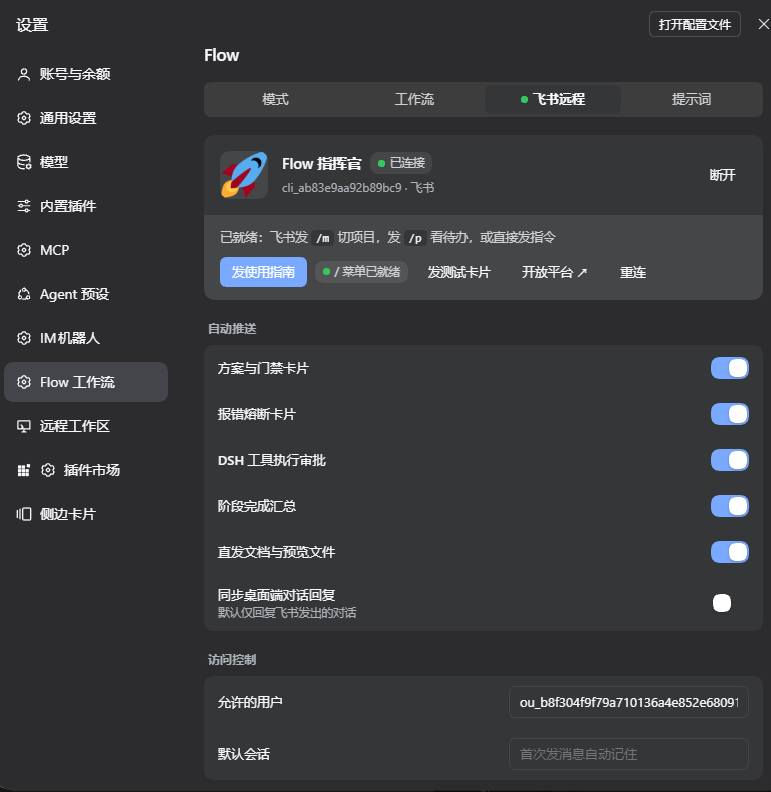
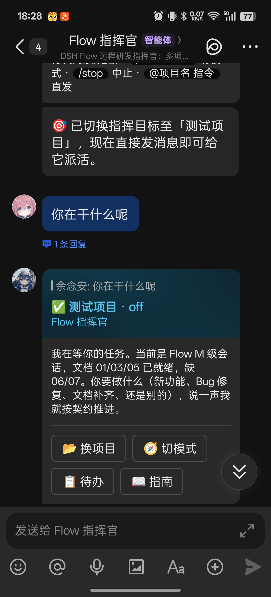
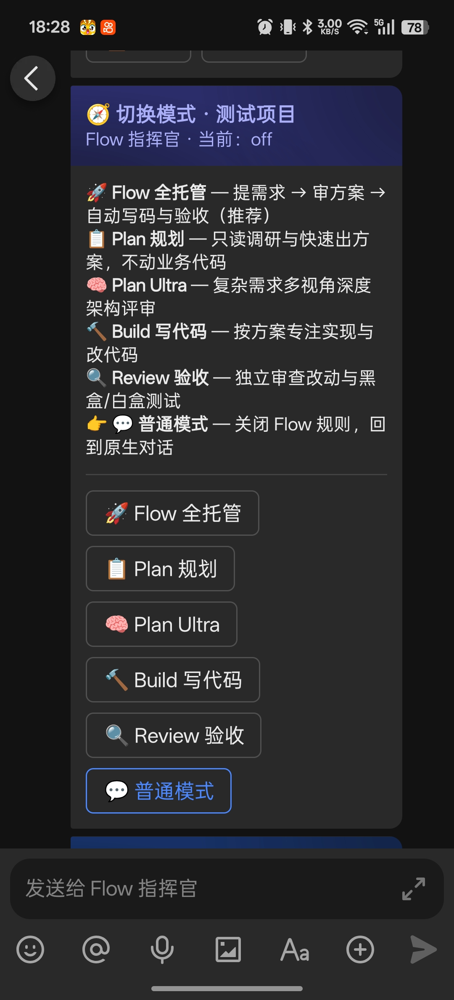
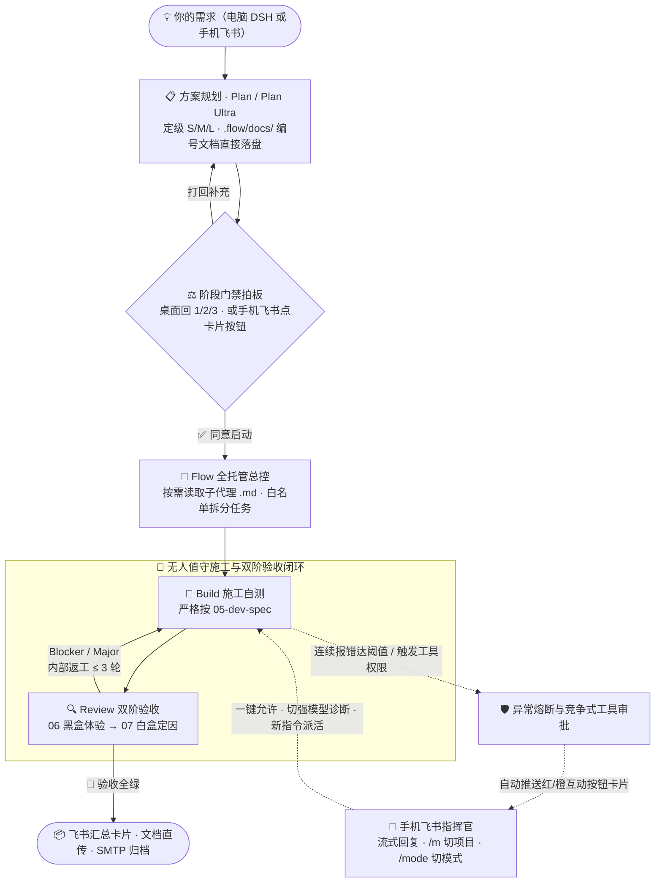
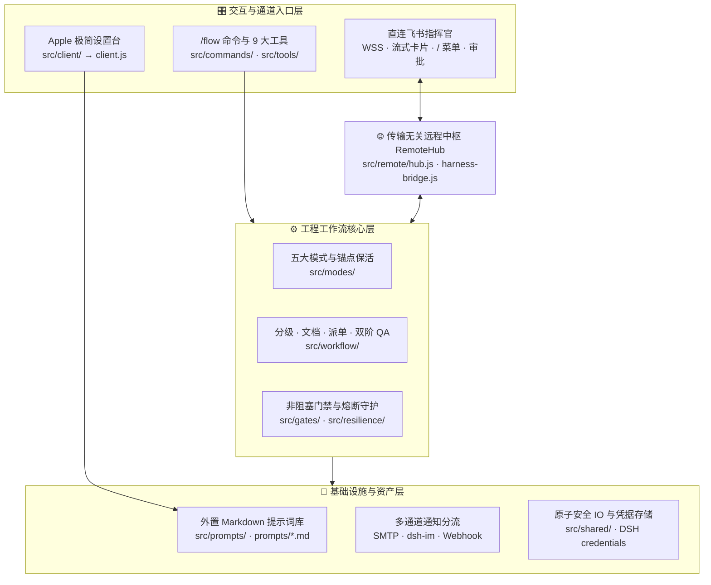

<p align="center">
  <picture>
    <source media="(prefers-color-scheme: dark)" srcset="./docs/assets/banner-dark.jpg" />
    <source media="(prefers-color-scheme: light)" srcset="./docs/assets/banner-light.jpg" />
    
  </picture>
</p>

<details align="center">
  <summary><sub>🌗 随 GitHub 主题自动切换 · 点此手动预览双主题门面（亮色陶瓷版 / 暗夜玻璃版）</sub></summary>
  <br/>
  <table width="100%">
    <tr>
      <td width="50%" align="center">
        <br/>
        <sub><b>亮色陶瓷工作室版</b>（亮色主题默认展示）</sub>
      </td>
      <td width="50%" align="center">
        <br/>
        <sub><b>暗夜磨砂玻璃版</b>（暗色主题自动切换）</sub>
      </td>
    </tr>
  </table>
</details>

<h1 align="center">dsh-flow</h1>

<p align="center">
  <b>专为 DeepSeek Harness 打造的工程化工作流管家、渐进式提示词编排器与直连飞书远程指挥官</b><br/>
  五大可控研发模式 · 编号文档直接落盘 · 连续报错熔断 · 手机飞书流式卡片 &amp; 多项目随时指挥
</p>

<p align="center">
  
  
  
  = 22" />
  
  
</p>

<p align="center">
  <b>简体中文</b> | <a href="./README.en.md">English</a>
</p>

---

### 为什么需要 dsh-flow？

直接用大模型做长链路开发时，最消耗精力的往往不是写不出代码，而是模型在失控状态下制造的返工：

* **抢跑盲写**：你只是想先理清思路、确认方案，AI 已经擅自选好技术栈改了十几个文件；
* **重复造破轮子**：项目里明明有现成组件、开源库或宿主能力，它却视而不见，从零手搓一个漏洞百出的替代品；
* **尾部疲劳与“孤儿代码”**：上下文一拉长，文件后半段质量断崖式下跌，写完新模块忘了接调用方，交付时还空口宣称“已完成”；
* **报错死循环与人机断联**：工具调用连续报错时原地撞墙烧光 Token；一旦你离开电脑，长任务、方案拍板或命令审批就彻底卡住。

`dsh-flow` 通过 **12 条硬工程契约 + 五段式可控研发流 + 连续报错熔断 + 内置直连飞书远程指挥官**，把 AI 从“需要时刻盯防的实习生”变成“有纪律、可托管、出门也能在手机上优雅遥控的工程团队”。

---

### 设计哲学与核心理念

1. **规矩写进代码，而不是赌模型听话**：只靠提示词“求 AI 别瞎改”早晚会翻车；`dsh-flow` 把文件写入白名单、阶段门禁票据、连续报错急刹、双阶返工次数上限全部做成**硬代码守卫**。
2. **把注意力留给决策，而不是点鼠标**：按任务规模自动分级（`S / M / L`）、`.flow/docs/` 免二次审批直接落盘、门禁非阻塞——只在真正需要你拍板的地方停下来问你，其余交给 Flow 内部自动闭环。
3. **跨端如一，人在哪里指挥台就在哪里**：桌面端与手机飞书共用同一个传输无关的 `RemoteHub` 中枢——流式卡片原地刷新、工具与门禁竞争式双端同步审批、桌面日常对话默认不刷手机。
4. **渐进式披露，零上下文浪费**：所有提示词外置为独立 Markdown 文件且支持热加载；主控平时只看精简目录索引，派单时才按需读取对应专家正文，保住高缓存命中率，且私有定制存于插件包外永不随升级丢失。
5. **零服务器、零黑盒、渐进式组合**：飞书远程指挥自带闭环，不需要公网 IP、内网穿透或前置 IM 插件，扫码 30 秒建连；基础模式开箱独立可用，重度多特种兵并发编排无缝联动 `dsh-team-control`；每次交付强制附带可审计验证回执。

---

### v0.6.0 重磅亮点

#### 1. 内置直连飞书指挥官（零服务器 · 零内网穿透 · 30 秒扫码即连）
* **自定义专属机器人，扫码一键建应用**：在设置页给机器人起名、挑头像（内置 6 枚图标或自定义公网 URL），点一下「扫码创建并连接飞书机器人」，手机飞书扫码确认后自动建立出站 WebSocket 长连接，**不需要公网 IP、不需要买服务器、不需要配 Tailscale**。
* **实时流式回复卡片**：在飞书直接像聊天一样提问，机器人立刻弹出动态卡片——AI 调工具时显示实时进度（附 `[⏹ 停止]` 按钮），输出正文时原地流式刷新，答完自动定稿为完整 Markdown 卡片并在底部附上 `[📂 换项目]` `[🧭 切模式]` `[📋 待办]` `[📖 指南]` 快捷按钮。
* **飞书原生 `/` 快捷指令菜单 + 开箱引导卡**：自动注册飞书原生 `/` 指令面板（输入框打 `/` 直接弹出 6 条常用指令），连上即发「3 秒上手欢迎卡片」，不用背命令就能玩转全部能力。
* **多项目自由切换与远程审批闭环**：
  * `/m` 打开项目指挥台卡片，随时在电脑上多个项目与会话间切换焦点，或用 `@项目名 你的指令` 一步派活；
  * `/mode` 弹出图形化六模式卡片，手机点一下即可切换电脑端会话的 Flow 模式；
  * **三大真互动审批卡片**：方案阶段门禁、连续报错熔断抢救、以及 **DSH 普通工具执行审批（`approval/request`）** 全部同步推送手机按钮卡片——手机和电脑任意一端先点即刻生效，另一端自动同步置灰防误点；
  * **防打扰分工**：飞书发起的对话 100% 实时回推；桌面端日常对话默认不刷手机，仅在需要你介入时推送（设置页提供「同步桌面端对话回复」开关，离开座位前可随手开启）。

#### 2. Apple 极简风格设置台
* 彻底重设计 4 个设置分页（`模式` / `工作流` / `飞书远程` / `提示词`），采用 Apple Inset 分组列表、分段控件、滑动开关与步进器，砍掉冗长说明文字，低频选项收纳进折叠高级区；
* 「飞书远程」采用三态引导配对卡片（未连接定制 → 居中高清矢量二维码与三步进度 → 已连接行动指引与一键补权），开箱一眼看懂下一步做什么。

#### 3. 工程工作流体验打磨 & 架构分层重构
* **`.flow/docs/` 免二次审批直接落盘**：`docs.writePolicy` 默认设为 `auto`（可随时切回 `ask`），业务代码依然严格受只读沙箱保护，文档落盘后一次送交阶段门禁拍板，并自动作为文件直传飞书；
* **全面分层架构与自动化回归测试**：原有 29 个根目录脚本重构为 `src/` 十一层清晰模块与模块化 `src/client/` 源码，补齐 25 项 `node:test` 自动化回归测试，修复包括模式芯片同步、裸数字桌面确认、熔断解锁防过期提醒、SMTP 多行 EHLO、DSH `credentials` 凭据规范等全部核心缺陷。

---

### 关于内置「直连飞书指挥官」与 `dsh-im` 插件的关系

很多用户会问：**既然生态里已经有优秀的 `dsh-im` 插件，为什么 `dsh-flow` v0.6.0 还要内置直连飞书能力？两者会冲突吗？**

| 维度 | `dsh-flow` 内置直连飞书指挥官（v0.6.0 起自带） | 搭配 `dsh-im` 插件（继续兼容，按需选装） |
| :--- | :--- | :--- |
| **定位** | 专为 **Flow 研发工作流** 深度定制的远程指挥台 | 通用多平台 IM 桥接插件（支持微信、企微、钉钉、飞书、Telegram 等） |
| **是否必装前置插件** | **无需安装任何前置插件**，装完 `dsh-flow` 扫码即用 | 如需微信/钉钉/企微等其他聊天软件接入时安装 |
| **多项目随时切换** | 原生支持 `/m` 项目指挥台、`@项目名 指令` 跨目录随时切目标派活 | 以会话/工作区绑定为主 |
| **工作流深度互动** | 流式回复卡片、`/` 菜单、`/mode` 图形切模式、门禁/熔断/工具审批按钮卡片原地置灰、`.flow/docs` 文档直传 | 纯文本摘要与数字指令兜底 |
| **共存关系** | **完全独立、零冲突**；飞书作为一级主通道，`dsh-im` / Webhook / SMTP 邮箱均可在设置页「邮箱与更多通道」里按需开启并存 | 可作为微信补充提醒渠道，与 `dsh-flow` 飞书或邮箱归档自由组合 |

> [!TIP]
> **怎么选最省心？**
> * 如果你愿意用**飞书**作为手机端远程开发控制台：只装 `dsh-flow` 一个插件就足够完整闭环，零额外配置；
> * 如果你习惯把提醒发到**微信 / 钉钉 / 企微**：在设置页「飞书远程 → 邮箱与更多通道」里打开 `dsh-im` 或自定义 Webhook 即可继续使用。

---

### 界面与真机实拍

#### 1. Apple 极简设置台与模式切换芯片

<table width="100%">
  <tr>
    <td width="50%" align="center" valign="top">
      <br/>
      <sub><b>工作流与异常熔断</b>：分段控件、滑动开关、步进器与折叠高级区</sub>
    </td>
    <td width="50%" align="center" valign="top">
      <br/>
      <sub><b>飞书远程指挥官</b>：在线状态、<code>/ 菜单已就绪</code>、6 项细粒度推送开关与白名单</sub>
    </td>
  </tr>
  <tr>
    <td colspan="2" align="center" valign="top">
      <br/>
      <sub><b>电脑端输入框左下角模式芯片</b>：一键切换 Plan / Plan Ultra / Build / Review / Flow，即时生效</sub>
    </td>
  </tr>
</table>

#### 2. 手机飞书指挥官真机实拍

<table width="100%">
  <tr>
    <td width="33%" align="center" valign="top">
      <br/>
      <sub><b>开箱欢迎与 3 秒上手指南</b><br/>连上自动送达，用法与指令全列清</sub>
    </td>
    <td width="33%" align="center" valign="top">
      <br/>
      <sub><b>飞书原生 <code>/</code> 快捷指令菜单</b><br/>输入框打 <code>/</code> 弹出列表，点选即发</sub>
    </td>
    <td width="33%" align="center" valign="top">
      <br/>
      <sub><b><code>/m</code> 多项目指挥台</b><br/>一键切换在线会话与历史工作区</sub>
    </td>
  </tr>
  <tr>
    <td colspan="3" align="center">
      <table width="100%">
        <tr>
          <td width="50%" align="center" valign="top">
            <br/>
            <sub><b>实时流式回复卡片</b>：手机直接提问，完整 Markdown 回复 + 底部 4 个快捷操作按钮</sub>
          </td>
          <td width="50%" align="center" valign="top">
            <br/>
            <sub><b><code>/mode</code> 图形化模式切换</b>：手机点一下即切换桌面会话模式并原地高亮</sub>
          </td>
        </tr>
      </table>
    </td>
  </tr>
</table>

---

### 核心架构与工程能力

#### 1. 十二条硬工程契约（`prompts/base.md`）
* **劳斯莱斯原则**：写通用能力前强制检索项目现有组件、宿主接口与开源生态，禁止无理由手搓低质替代品；
* **实证优先与 2 次止损**：以真实运行态反馈为准；同一报错连续失败 2 次强制停手复盘根因，禁止空转微调；
* **非阻塞门禁与反脑补**：关键设计不静默拍板；调用 `flow_stage_gate` 展示选项后必须立刻停手等待你的确认；
* **下载红绿灯 & 不可逆操作红线**：大体积下载（绿 `<20MB` / 黄 `20–300MB` / 红 `≥300MB`）与删库/强推等破坏性操作一律前置确认；
* **可审计验证回执**：严禁空口宣称“已完成”，每次交付必须附带核对文件、实测命令结果与未验证项。

#### 2. S / M / L 分级与 `.flow/docs/` 七份编号文档体系
* **S 级（局部小改动）**：不产文档，强制 1 轮交互形态确认后直接施工；
* **M 级（中型功能）**：产出 `01-requirements` / `03-tech-design` / `05-dev-spec`（施工唯一法典 SSOT）/ `06-blackbox-qa` / `07-whitebox-qa`；
* **L 级（从零建项 / 重构）**：产出全套 `01–07` 编号文档；
* **方案锚点防失忆**：`.flow/spec.md` 摘要在上下文压缩后自动重新挂载，长对话绝不偏航；
* **黑盒 → 白盒双阶验收**：`qa-blackbox` 不看源码体验点验，`qa-whitebox` 带症状定位 `文件:行号`，返工 1–3 轮自动闭环、第 4 轮硬拦上报。

#### 3. 全链路运转全景



#### 4. 系统分层架构（v0.6.0 模块化全景）

`dsh-flow` 采用清晰的四层解耦架构：核心工作流与远程通道通过传输无关的 **`RemoteHub`** 隔离，既让飞书直连做到原生丝滑，也为后续接入更多远控形态（如 Mobile PWA / 隧道等）保留零侵入扩展位。



#### 5. 五大工作模式与内置十大专精子代理

| 模式 | 权限与定位 | 核心工作机制 |
| :--- | :--- | :--- |
| **`Flow`** | 全权 · 全托管总控大队长（推荐日常默认） | **一次确认、全程托管**：路由定级 → 文档直接落盘 → 门禁拍板 → 拆包施工 → 双阶验收自动返工闭环。 |
| **`Plan`** | 只读 · 产品与架构搭档 | 需求边界对齐、现成轮子调研、技术与 UI 蓝图设计，确认前零业务代码改动。 |
| **`Plan Ultra`** | 只读 · 多专家并行会诊 | 继承 `Plan`，并行调遣多视角子代理交叉质询与三维方案审计。 |
| **`Build`** | 可写 · 高纪律施工队 | 严格按 `05-dev-spec.md` 施工，核查上下游接线并附带可审计验证回执。 |
| **`Review`** | 只读 · 双视角对抗验收 | 兼顾黑盒用户体感与白盒代码审计，按 `Blocker / Major / Minor` 输出 `文件:行号` 审查单。 |

<details>
<summary><b>展开查看内置十大专精子代理（<code>prompts/subagents/</code>）与自定义扩展机制</b></summary>

<br/>

* **`product-scout`**（产品与开源轮子侦察兵） · **`ui-architect`**（UI 布局与交互设计师） · **`plan-auditor`**（方案三维审计员）
* **`build-worker`**（白名单施工员） · **`reverse-engineer`**（逆向与底层分析专家） · **`deep-debugger`**（疑难排障与日志取证专家）
* **`security-auditor`**（安全与并发审计专家） · **`qa-tester`**（独立对抗式测试专家） · **`qa-blackbox`**（黑盒体验官） · **`qa-whitebox`**（白盒定因官）

所有提示词均解耦为外置 Markdown 文件并支持热加载；你的私有定制与新增子代理保存在**插件包之外**的数据目录（`$DSH_PROFILE_DIR/data/dsh-flow/prompts/custom`，回落 `~/.dsh-flow/prompts/custom`），在线一键增量更新官方提示词或升级插件时**绝不覆盖**你的私有配置。

</details>

---

### 安装、生态组合与快速上手

#### 环境要求与生态插件说明

* **环境要求**：DeepSeek Harness `0.2.x` 及以上 · Node.js `22` 及以上

> [!IMPORTANT]
> **插件组合说明（一眼分清自带能力、强烈推荐底座与可选扩展）**
>
> | 能力 / 插件 | 定位与必要性 | 说明 |
> | :--- | :--- | :--- |
> | **`dsh-flow` 本体** | **独立开箱可用** | 已自带五大模式、编号文档与门禁、熔断保护、内置 SMTP 邮箱及**直连飞书指挥官**，单装即可完整跑通规划、单兵施工、验收与手机飞书远程操控。 |
> | **[dsh-team-control](https://github.com/hunmer/dsh-team-control/)**（[@hunmer](https://github.com/hunmer)） | **🔥 使用 `Flow` 团队编排强烈推荐** | `Flow` / `Plan Ultra` 派单优先调用 `dsh-team-control` 提供的 `dsh_team_spawn` 与团队协作 SSE 监控。**装了它**才能发挥满血的多特种兵并行施工、团队看板与异常自动推送；**未安装时**不会报错，会自动降级为宿主原生 `subagent` 或单线程施工并在回执里注明。 |
> | **[dsh-im](https://github.com/xmanrui/dsh-im)**（[@xmanrui](https://github.com/xmanrui)） | **可选（按需）** | v0.6.0 起不再强制依赖；仅当你还需要将提醒接入**微信 / 钉钉 / 企业微信**等其他聊天软件时选装，与内置飞书指挥官零冲突。 |

```bash
# 从 GitHub 安装到指定 profile（示例为 web，桌面端把 web 换成 desktop）
dsh plugin --profile web add github:MeZenith/dsh-flow
```

安装完成后重启 DSH，在浏览器按 `Ctrl + R` 刷新即可在设置页看到 **「Flow 工作流」**。

> **本地源码目录开发（`link:` 方式安装）**：在插件目录执行一次 `npm install` 安装 `@larksuiteoapi/node-sdk` 即可；通过上方 `dsh plugin add github:...` 安装的用户由 DSH 自动安装依赖，无需手动操作。

#### 30 秒配好手机飞书指挥官
1. 打开 DSH 设置 → **Flow 工作流 → 飞书远程**；
2. 给机器人起个名字、点选一个喜欢的头像，点击 **「扫码创建并连接飞书机器人」**；
3. 用手机飞书扫屏幕上的二维码并点「确认创建」——完成后自动建连、自动同步原生 `/` 快捷菜单，并立刻往你飞书发一张 **欢迎使用指南卡片**！

#### 升级与更新

```bash
# 1. 原地更新插件本体（推荐，保留全部配置、凭据与私有提示词）
dsh plugin --profile web update dsh-flow

# 2. 若需兜底重装
dsh plugin --profile web remove dsh-flow
dsh plugin --profile web add github:MeZenith/dsh-flow
```

* **仅更新官方提示词库**：在会话里运行 `/flow prompts update`，或在设置页「提示词」点 **检查更新**（按 `sha256` 增量更新，私有目录永不覆写）。

---

### 指令速查表

<details>
<summary><b>展开查看飞书端 &amp; 桌面端全部快捷指令</b></summary>

<br/>

#### 手机飞书指令（输入框打 `/` 即可点选）

| 指令 / 触发方式 | 效果 |
| :--- | :--- |
| 直接发任意消息 | 转交当前聚焦的桌面项目，以**实时流式卡片**回复 |
| `/m` 或 `项目` | 打开**项目指挥台卡片**，一键切换在线会话与工作区 |
| `/mode` 或 `模式` | 打开**六模式选择卡片**（或 `/mode build` 直接切换） |
| `/p` 或 `待办` | 拉取当前所有待拍板门禁卡片与熔断抢救卡片 |
| `/stop` 或 `停止` | 立即中止当前项目正在运行的 AI 回合 |
| `@项目名 你的指令` | 一步切换目标项目并立刻下达任务 |
| `/new 目录名 首条指令` | 在目标目录新建并切入会话 |
| `/help` 或 `你好` / `菜单` | 发送完整开箱引导卡片与指令速查 |
| `/id` | 查看你的飞书 `open_id`（填入设置页「允许的用户」开启白名单保护） |
| `#票据号 1 你的意见` | 回复指定门禁并附带修改意见（也可直接点卡片按钮） |

#### 桌面端 `/flow` 命令

| 命令 | 说明 |
| :--- | :--- |
| `/flow plan` | 切换模式（支持 `plan` / `plan-ultra` / `build` / `review` / `flow` / `off`） |
| `/flow` | 查看当前会话模式与活跃状态 |
| `/flow spec` / `/flow compact` | 查看 `.flow/spec.md` 锚点状态 / 手动触发带锚点保活的上下文压缩 |
| `/flow gate list` / `answer` / `skip` / `release` | 查看或结算挂起的阶段门禁票据（单票时也可直接回复裸数字 `1/2/3/0`） |
| `/flow feishu status` / `connect` / `disconnect` / `test` | 查看或管理直连飞书长连接并发送测试卡片 |
| `/flow prompts list` / `update` | 查看本地提示词版本与清单 / 在线增量更新官方提示词 |
| `/flow notify-test` | 一键自检飞书、邮箱与兼容 IM 通道 |
| `/flow retry` / `escalate` / `resume` | 熔断后手动重试 / 切换救场强模型 / 解除暂停 |

</details>

完整架构设计、目录分层、状态机细节与本地回环 API 文档请参阅 **[docs/DETAIL.md](./docs/DETAIL.md)**；历史变更见 **[CHANGELOG.md](./CHANGELOG.md)**。

---

### 鸣谢

* **[OpenCode](https://github.com/anomalyco/opencode)**：本项目的 `Plan` / `Build` 职责划分与多模式切换工作流设计，深受 OpenCode 架构思路启发。
* **[dsh-team-control](https://github.com/hunmer/dsh-team-control/)**（[@hunmer](https://github.com/hunmer)）：为 DeepSeek Harness 生态提供团队编排与协作监控底座。
* **[dsh-im](https://github.com/xmanrui/dsh-im)**（[@xmanrui](https://github.com/xmanrui)）：为 DeepSeek Harness 生态提供优秀的多平台 IM 接入方案与飞书 SDK 实践参考。

---

### 开源协议

本项目采用 **[PolyForm Noncommercial License 1.0.0](./LICENSE)** 发布：

* **允许**：个人使用、学习研究、非商业用途下的修改、二次开发与分发；
* **禁止**：任何形式的商业用途（商用产品集成、收费服务或营利性分发）；
* **强制署名**：任何二次开发或再分发行为，**必须明确注明使用了 `dsh-flow` 代码或基于本项目二次开发**，并完整保留 `LICENSE` 原文及下方声明：

```text
Required Notice: Copyright (c) 2026 MeZenith (https://github.com/MeZenith/dsh-flow).
Any derivative work or redistribution must clearly attribute dsh-flow and its original author.
```

`vendor/` 目录下第三方组件的许可条款请参阅 [THIRD_PARTY_NOTES.md](./THIRD_PARTY_NOTES.md)。
