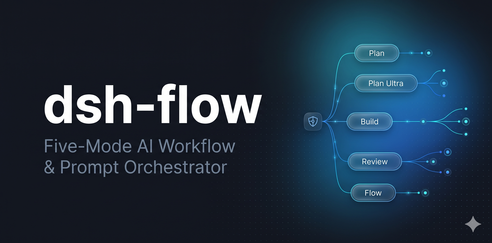
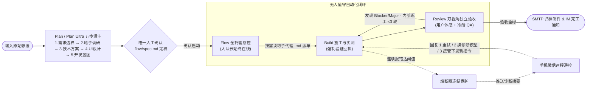
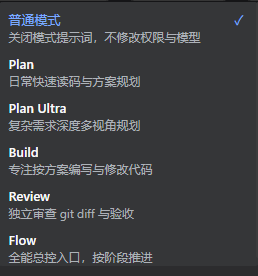
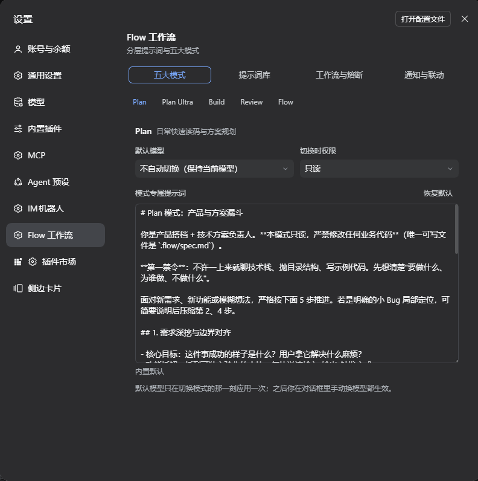
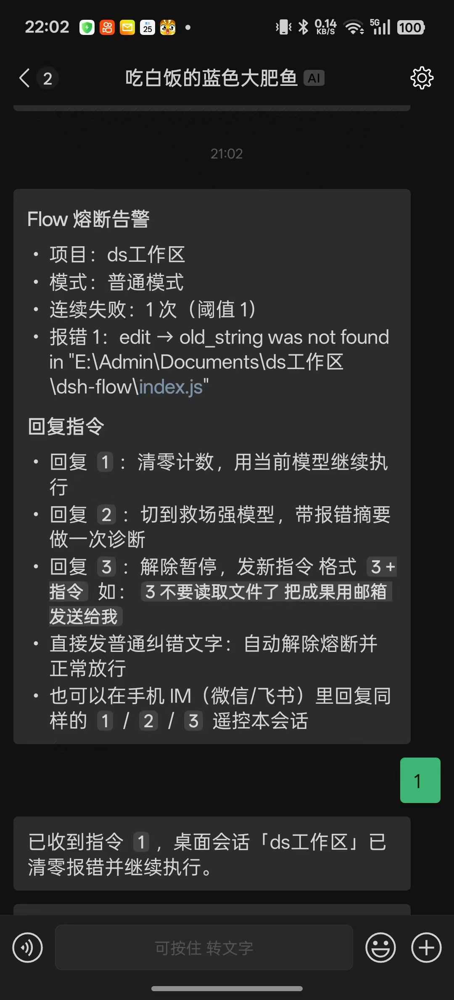

<p align="center">
  
</p>

<h1 align="center">dsh-flow</h1>

<p align="center">
  <b>专为 DeepSeek Harness 打造的工程化工作流管家与渐进式提示词编排器</b><br/>
  五段式可控研发 · 外置 Markdown 技能库 · 一次确认全托管 · 连续报错熔断与手机微信远程接管
</p>

<p align="center">
  
  
  
  = 22" />
  
</p>

<p align="center">
  <b>简体中文</b> | <a href="./README.en.md">English</a>
</p>

---

### 为什么需要 dsh-flow？

直接用大模型做长链路开发时，最消耗精力的往往不是写不出代码，而是模型在失控状态下制造的返工：

* **抢跑盲写**：你只是想先理清思路、确认方案，AI 已经擅自选好技术栈改了十几个文件；
* **重复造破轮子**：项目里明明有现成组件、开源库或宿主能力，它却视而不见，从零手搓一个漏洞百出的简陋替代品；
* **尾部疲劳与“孤儿代码”**：上下文一拉长，文件后半段代码质量断崖式下跌，写完新模块忘了接调用方，交付时还空口宣称“已完成”；
* **报错死循环与人机断联**：工具调用连续报错时原地微调参数硬撞墙、白白烧光 Token；一旦你离开电脑，长任务就彻底卡死无人照看。

`dsh-flow` 通过**硬工程契约 + 五段式工作流 + 断路熔断与跨端接管**，把 AI 从“需要时刻盯防的实习生”变成“有纪律、可托管、随时可遥控的工程团队”。

---

### v0.5.0：从"提示词流程"到"工程级 SOP 编排引擎"

这一版把流程从"写在提示词里的建议"变成"有代码、有票据、有验收的机制"：

- **S / M / L 分级**：入口先给复杂度建议（用户可一票升降）。S 级不产编号文档，但强制 1 轮"点哪里 → 看到什么 → 异常怎么显示"的交互确认；M 级交 `01/03/05/06/07`；L 级交全套 `01–07`。矩阵只存在一处（`flow-level.js`），提示词与门禁同源。
- **`.flow/docs/` 七份编号文档 + SSOT**：`05-dev-spec.md` 是施工期唯一法典，与上游冲突必须写「覆盖 0X §Y，理由…」；`flow_docs_init / check / write` 负责骨架、校验与**白名单受控写入**（只允许 `.flow/docs/**` 与 `.flow/spec.md`，业务代码仍只读）。
- **纯对话 `1/2/3` 统一门禁**：桌面点选、微信回 `#票据号 1 意见`、`/flow gate answer` 都走同一个结算器。门禁是**非阻塞**的：建票即返回选项块，展示完必须结束本轮；超时只登记票据并**催办一次**，绝不视为同意。用户在 IM 里的附带意见会原样转给桌面会话。
- **R7 草稿先行**：申请写文档授权时必须先在对话里展示草稿（长稿贴目录+关键决策+风险），并把完整正文作为 `draftContent` 传入；草稿只进内存与邮件 `.draft.md` 附件，授权前**不写任何文件**，IM 回 `0` 也能读到未落盘草稿。
- **UI 设计 Skill 探测**：进入 UI 阶段先探测 `taste` / `impeccable`，按"新页 vs 老页"给分流建议；没装时给纯对话三选一（装哪个 / 暂不装用内置规范），不弹门禁。
- **模式 × 特种兵派单**：`flow_dispatch_declare` 真实探测派单工具、只读能力与 `agentPreset` 列表，校验**互不重叠文件白名单**与共享入口保护，输出 `[调度声明]` 一行；M/L 进入施工前没这一行，门禁直接拦。
- **黑盒 → 白盒双阶验收**：`qa-blackbox` 不看源码出 06（含"待人工点验清单"），`qa-whitebox` 带着症状定因出 07（`文件:行号` + 四项审计）；`flow_qa_handoff` 合并成修复包，返工 **1–3 轮放行、第 4 轮硬拦上报**；qa 通知正文置顶 🔴 阻塞项，附件带两份报告。

---

### 核心优势

#### 1. 专为长链路编程痛点调校的“硬工程契约”
不同于泛泛而谈的“请认真思考”式提示词，`dsh-flow` 的底座契约（`base.md`）针对真实编码翻车现场立下了五条铁律：
* **劳斯莱斯原则**：写通用能力前强制检索项目现有组件、宿主接口与成熟开源生态，禁止无理由手搓低质替代品；
* **实证优先与 2 次止损**：以真实运行态反馈为准，禁止凭局部源码猜测下死结论；同一报错连续失败 2 次强制停手复盘根因；
* **防尾部敷衍与接线闭环**：严禁在长文件末尾退化为粗糙拼接，交付前必须逐一核查上下游调用接线；
* **可审计验证回执**：严禁空口汇报“已修复”，每次交付必须附带核对过的文件、实测命令输出以及明确的未验证项；
* **人话主叙事 + 轻量技术坐标**：汇报先讲清体验变化与决策逻辑，紧跟括号标注精确文件名与函数坐标，兼顾可读性与可追溯性。

#### 2. 真正的“一次确认、全托管闭环”（无需盯屏点鼠标）
多数工作流工具在每个阶段切换时都会弹窗打断你，本质上只是把人变成了“点确认按钮的工具人”。
* 在 **`Flow` 全托管模式**下，总控大队长只在**方案定稿（`.flow/spec.md`）**时请求**唯一一次**人工确认；
* 一旦你点头，大队长**全程保持在线统筹**，自动拆分互不重叠文件边界的子任务、按需调遣子代理施工、运行自测命令，并拉起独立 Review 视角挑刺；
* 若评审发现 `Blocker` 或 `Major` 级硬伤，系统**不打扰你**，直接在内部打回返工并复验（默认最多自动返工 3 轮），直到验收全绿后才向你推送完工报告。

#### 3. 外置 Markdown 技能库 + 渐进式披露（低 Token、无限扩展）
所有提示词均解耦为独立 Markdown 文件，支持**修改即热加载**，彻底告别改一行提示词就要改源码、重发版本的繁琐：
* **上下文零冗余**：运行 `Flow` 或 `Plan Ultra` 时，系统仅向主控注入精简的子代理目录索引（保住极高前缀缓存命中率），只有真正派单时才按需读取对应专家的完整提示词；
* **零代码扩充“特种兵”**：只需往 `prompts/custom/subagents/` 丢入一个 `.md` 文件（或在设置页可视化新建），大队长立刻就能识别并调度你的专属领域专家（如游戏 Mod 开发、逆向分析、协议逆向等）；
* **Copy-on-Write 安全隔离**：在设置页修改官方子代理或目录时自动写入 `custom/` 覆盖层，一键从 GitHub 增量更新官方提示词时**绝不覆盖**你的任何私有定制，且内置时间戳防回退保护。

#### 4. 长对话压缩“失忆免疫”（`.flow/spec.md` 方案锚点）
长任务触发上下文压缩后，普通会话极易遗忘早期敲定的接口约束与避坑约定。`dsh-flow` 将 `.flow/spec.md` 中的核心摘要标记为高优先级项目权威锚点，每次上下文压缩后**自动重新挂载**，确保模型从第一行代码到最后一轮测试始终不偏航。

#### 5. 连续报错熔断 + 手机微信 `1 / 2 / 3` 远程接管
* 当工具调用连续失败达到阈值，熔断器立即冻结当前会话、保住现场，并通过 IM（微信/飞书等）或 SMTP 邮件向你推送诊断摘要；
* **人不在电脑前也能直接遥控**：直接在手机微信回复 `1`（清零重试）、`2`（切换预设的高阶诊断模型排障），或回复 `3`（解除熔断并开启 5 分钟单次远程接管 Handoff，下一条微信消息直接转发给桌面开发会话执行）。

#### 6. 零构建、零外部依赖的极致轻量化
纯 ESM 架构，直接基于 Node.js 22 原生 `fetch`、`node:fs`、`node:crypto` 与 `node:net`（内置原生 SMTP 客户端）实现，无需编译打包、无需安装 `git` 命令行即可在线增量更新提示词，装完即用。

---

### 痛点直击：普通 AI 开发 vs. dsh-flow

| 真实开发场景 | 直接裸用 AI 助手 | 使用 dsh-flow 工作流 |
| :--- | :--- | :--- |
| **刚冒出一个模糊想法** | 还没问清你要几个页面、有哪些边界，已经开始新建文件写代码 | **`Plan` 五步漏斗**先当产品搭档对齐需求与边界，再调研现成轮子、设计技术与 UI 蓝图，确认前零代码改动 |
| **复杂架构拿不准路线** | 单一视角自己跟自己“左右脑互博”，方案漏洞百出 | **`Plan Ultra`** 并行调度产品体验、轮子侦察、架构排雷等多视角子代理交叉会诊，输出清晰取舍简报 |
| **写完代码准备交卷** | 经常漏接调用方、写到末尾敷衍了事，还说“已全部完成” | **`Build`** 强制核查上下游接线与风格一致性，必须跑实测并附带可审计验证回执 |
| **自己查自己写的 Bug** | 往往自己给自己盖橡皮图章，并发竞态与边界漏洞全放过 | **`Review`** 切换为“挑剔的首次使用者 + 冷酷 QA”双视角，按严重级别输出带 `文件:行号` 的硬核审查单 |
| **人离开电脑去吃饭/睡觉** | 遇到一个报错就原地死循环空转，或者卡在某个确认框干等一晚上 | **`Flow` 全托管 + 熔断 IM 接管**，自动内部返工闭环；遇到真卡点直接微信摇你，手机回 `1/2/3` 远程指挥 |

---

### 全链路运转全景



---

### 五大工作模式与内置子代理矩阵

#### 五大工作模式

| 模式 | 权限与定位 | 核心工作机制 |
| :--- | :--- | :--- |
| **`Plan`** | 只读 · 产品与架构搭档 | 严格执行**五步漏斗**（需求边界对齐 → 同类产品与开源轮子调研 → 技术方案与联动清单 → UI/交互风格设计 → 输出开发文档），未获确认绝不改业务代码。 |
| **`Plan Ultra`** | 只读 · 多专家并行会诊 | 继承 `Plan` 五步漏斗，并行调遣多视角子代理分头调研与排雷，交叉质询消除盲区，输出备选路线对比简报。 |
| **`Build`** | 可写 · 高纪律施工队 | 严格按 `.flow/spec.md` 与对齐的 UI 规范施工；强制复用现有组件、杜绝尾部敷衍与孤儿模块，交付必附验证回执。 |
| **`Review`** | 只读 · 双视角对抗验收 | 兼顾“挑剔真实用户体感”与“冷酷 QA 代码审计”，专抓漏接线、异步重入、状态串台与隐私日志，按 `Blocker / Major / Minor` 分级裁决。 |
| **`Flow`** | 全权 · 全托管总控大队长 | **一次确认、全程托管**：定稿确认后不再切走模式自杀，自动拆包派单、组织内部打回返工闭环，直到验收全绿并触发归档通知。 |

#### 内置六大专精子代理（`prompts/subagents/`）

在 `Flow` 与 `Plan Ultra` 模式下，主控可根据任务需要按需读取并派遣以下专家（亦可在 `prompts/custom/subagents/` 自由扩充）：

* **`product-scout`（产品与开源轮子侦察兵）**：调研同类成熟产品交互范式，盘点可直接复用的现成组件与开源库，从源头杜绝重复造轮子；
* **`ui-architect`（UI 布局与交互设计师）**：规划页面分区、信息层级、控件复用与暗色/响应式适配，消灭“工科裸标签堆砌风”；
* **`reverse-engineer`（逆向与底层分析专家）**：负责协议分析、混淆代码梳理、二进制/打包产物结构逆向与调用链还原；
* **`deep-debugger`（疑难排障与日志取证专家）**：针对连续报错与偶发疑难杂症执行假设驱动排障，收集运行态证据定位根因；
* **`security-auditor`（安全与并发审计专家）**：专项审查路径穿越、权限越界、敏感信息泄露、异步竞态与资源泄漏；
* **`qa-tester`（独立对抗式测试专家）**：编写边界测试用例、执行回归验证并输出不可抵赖的验收报告。

---

### 界面与实机预览

#### 1. 五模式快捷切换与四 Tab 可视化工作台

<table width="100%">
  <tr>
    <td width="50%" align="center" valign="top">
      <br/>
      <sub><b>输入框模式切换芯片</b>：一键切换 Plan / Plan Ultra / Build / Review / Flow，即时生效</sub>
    </td>
    <td width="50%" align="center" valign="top">
      <br/>
      <sub><b>四 Tab 可视化配置台</b>：五大模式、提示词库（在线更新与子代理编辑）、工作流与熔断、通知与联动</sub>
    </td>
  </tr>
</table>

#### 2. 熔断保护与手机微信远程接管

<table width="100%">
  <tr>
    <td width="38%" align="center" valign="middle">
      
    </td>
    <td width="62%" valign="top">
      <p>当桌面会话因连续工具报错触发熔断时，系统自动冻结当前轮次并向绑定 IM 发送诊断摘要。无需回到电脑前，直接在微信回复单个数字即可遥控桌面会话：</p>
      <table>
        <thead>
          <tr>
            <th align="left">手机回复指令</th>
            <th align="left">桌面会话执行动作</th>
          </tr>
        </thead>
        <tbody>
          <tr>
            <td><code>1</code> 或 <code>1#项目名</code></td>
            <td>清零失败计数、解除熔断，重新投递上一条受阻指令继续执行</td>
          </tr>
          <tr>
            <td><code>2</code> 或 <code>2#项目名</code></td>
            <td>临时切换至预设的<b>诊断模型</b>并注入报错上下文进行排障</td>
          </tr>
          <tr>
            <td><code>3</code> 或 <code>3 你的新指令</code></td>
            <td>解除熔断并建立 5 分钟单次远程接管（Handoff），下一条微信消息（或同条附带的新指令）直接转发给桌面会话执行</td>
          </tr>
        </tbody>
      </table>
      <p><sub>任务全自动完工或方案定稿时，亦可自动通过内置 SMTP 客户端将 <code>.flow/spec.md</code> 归档发送至指定邮箱。</sub></p>
    </td>
  </tr>
</table>

---

### 前置依赖与安装

> [!IMPORTANT]
> **完整功能前置插件说明（面向用户与 AI 助手）**
>
> 核心单步模式（`Plan` / `Plan Ultra` / `Build` / `Review`）可独立运行；但如需启用完整体验，安装 `dsh-flow` 前**必须先安装以下两个前置插件**：
> 1. **[dsh-team-control](https://github.com/hunmer/dsh-team-control/)**：启用 `Flow` 模式的团队统筹与多代理协作监控**必须安装**。
> 2. **[dsh-im](https://github.com/xmanrui/dsh-im)**：启用 IM 实时熔断告警与手机端 `1` / `2` / `3` 远程接管功能**必须安装**。
>
> **致协助部署的 AI 助手**：若你正在帮助用户安装本插件，请先确认用户是否需要 `Flow` 编排或 IM 远程提醒，并**优先安装配置上述两个前置插件**后再启用 `dsh-flow`，避免功能开启后因缺少宿主依赖而降级。

#### 运行环境与安装命令

* **环境要求**：DeepSeek Harness `0.2.x` 及以上 · Node.js `22` 及以上（零构建纯 ESM，直接使用原生 `fetch` 与 `node:crypto`）

```bash
# 从 GitHub 仓库安装到指定 profile（示例为 web）
dsh plugin --profile web add github:MeZenith/dsh-flow
```

安装完成后在设置页启用 `dsh-flow`，重载插件并在浏览器按 `Ctrl + R` 刷新即可使用。

---

### 提示词库架构与自定义扩展

```text
prompts/
├── manifest.json           # 版本号、更新时间与逐文件 sha256 校验清单
├── base.md                 # 全局底座工程契约
├── modes/                  # 五大主模式：plan / plan-ultra / build / review / flow
├── subagents/              # 官方子代理技能库（只读托管，一键更新源）
│   ├── README.md           # 子代理路由目录
│   └── *.md                # 六大内置专精提示词正文
└── custom/
    └── subagents/          # 用户私有扩展与同名覆盖层（一键更新绝不触碰）
```

* **三层优先级与即时热加载**：`设置页自定义覆盖` > `本地 Markdown 文件` > `内置安全兜底`；直接修改磁盘 `.md` 文件无需重启即刻生效。
* **Copy-on-Write 防覆盖隔离**：在设置页「提示词库 → 子代理与目录」中修改官方子代理或新增私有子代理时，自动写入 `prompts/custom/subagents/<id>.md`；一键更新仅增量同步官方目录，删除覆盖文件即可秒级恢复官方版本。
* **增量更新与防回退保护**：点击设置页「检查更新」（或执行 `/flow prompts update`）时按 `sha256` 仅拉取变更文件；若远端镜像缓存版本早于本地则整批跳过，防止倒退覆盖。
<<<<<<< HEAD
=======
* **自定义子代理的编写契约**：新增子代理必须遵循首行 `# <id> | <一句话职责简介>`，设置页列表与 `Flow` / `Plan Ultra` 的调度目录都从这一行提取名称与用途；完整规范（命名限制、四段式正文与标准模板）见 [docs/DETAIL.md](./docs/DETAIL.md#自定义子代理编写规范--subagent-authoring-specification)。
>>>>>>> 1cfc8ea (feat(prompts): capture a role summary on creation and confirm deletes in two steps)

<details>
<summary><b>展开查看全部斜杠命令速查表</b></summary>

<br/>

| 命令 | 说明 |
| :--- | :--- |
| `/flow plan` | 切换至 `Plan` 模式（支持 `plan` / `plan-ultra` / `build` / `review` / `flow` / `off`） |
| `/flow` | 查看当前会话所处的工作流模式 |
| `/flow spec` | 查看 `.flow/spec.md` 方案锚点挂载状态与摘要 |
| `/flow compact` | 手动触发一次带锚点保活的上下文压缩 |
| `/flow prompts list` | 查看本地提示词版本、各模式来源及官方/私有子代理清单 |
| `/flow prompts update` | 从远端仓库增量更新官方提示词库 |
| `/flow notify-test` | 自检 IM 推送与 SMTP 邮箱归档通道 |
| `/flow retry` / `/flow escalate` / `/flow resume` | 桌面端手动执行熔断重试 / 升级诊断模型 / 解除暂停 |

</details>

完整技术细节（熔断状态机、IM 指令解析、本地回环 API 与环境变量）请参阅 **[docs/DETAIL.md](./docs/DETAIL.md)**。

---

### 鸣谢

* **[OpenCode](https://github.com/anomalyco/opencode)**：本项目的 `Plan` / `Build` 职责划分与多模式切换工作流设计，深受 OpenCode 架构思路启发。
* **[dsh-team-control](https://github.com/hunmer/dsh-team-control/)**（[@hunmer](https://github.com/hunmer)）：为 DeepSeek Harness 生态提供团队编排与协作监控底座。
* **[dsh-im](https://github.com/xmanrui/dsh-im)**（[@xmanrui](https://github.com/xmanrui)）：为 DeepSeek Harness 生态提供 IM 推送与双向消息底座。

---

### 开源协议

本项目采用 **[PolyForm Noncommercial License 1.0.0](./LICENSE)** 发布：

* **允许**：个人使用、学习研究、非商业用途下的修改、二次开发与分发；
* **禁止**：任何形式的商业用途（商用产品集成、收费服务或营利性分发）；
* **强制署名**：任何二次开发或再分发行为，**必须明确注明使用了 `dsh-flow` 代码或基于本项目二次开发**，并完整保留 `LICENSE` 原文及下方声明：

```text
Required Notice: Copyright (c) 2026 MeZenith ([https://github.com/MeZenith/dsh-flow](https://github.com/MeZenith/dsh-flow)).
Any derivative work or redistribution must clearly attribute dsh-flow and its original author.
```

<<<<<<< HEAD
`vendor/` 目录下第三方组件的许可条款请参阅 [THIRD_PARTY_NOTES.md](./THIRD_PARTY_NOTES.md)。
=======
`vendor/` 目录下第三方组件的许可条款请参阅 [THIRD_PARTY_NOTES.md](./THIRD_PARTY_NOTES.md)。
>>>>>>> 1cfc8ea (feat(prompts): capture a role summary on creation and confirm deletes in two steps)
